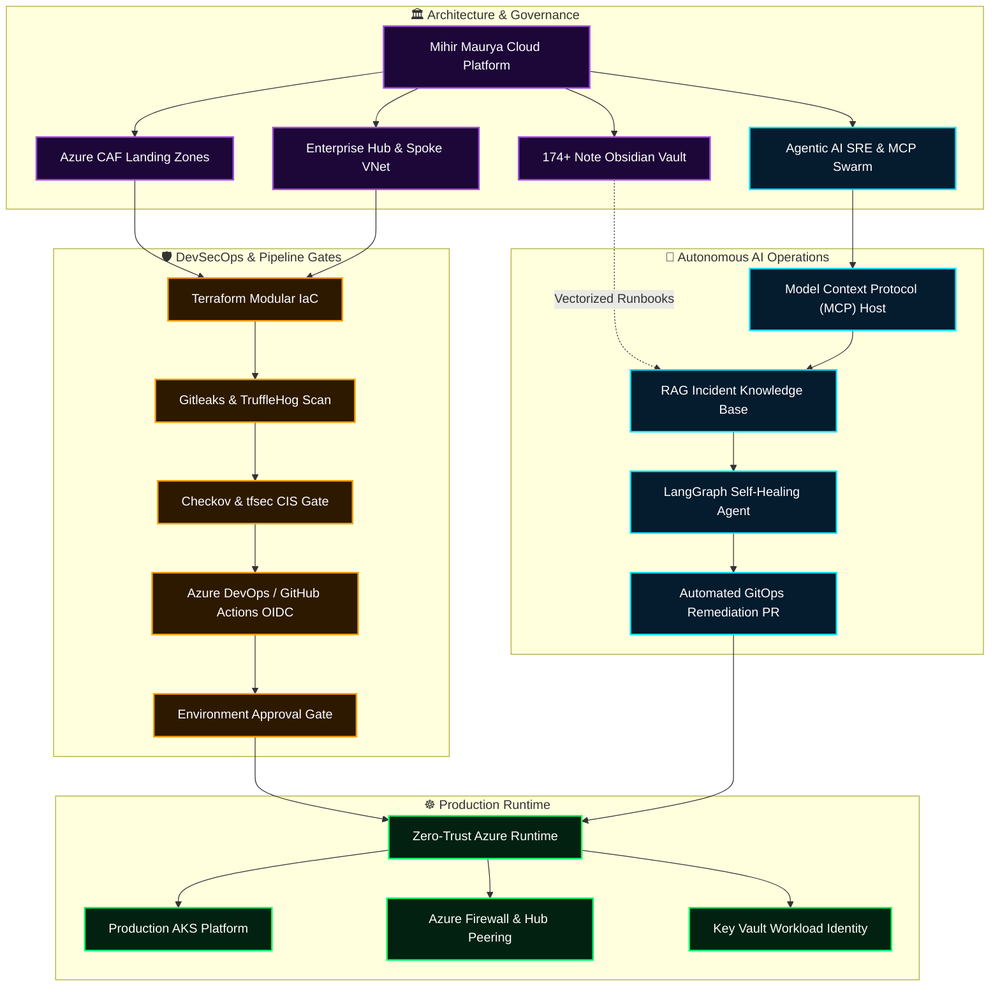

<div align="center">


<a href="https://readme-typing-svg.demolab.com/">
  
</a>

### ⚡ Enterprise Cloud Solutions Architect & DevSecOps Engineer | Agentic AI Systems

**Production Azure Infrastructure · Zero-Trust IaC · Shift-Left DevSecOps · Autonomous SRE Swarms**

[](https://mihirmaurya-dev.github.io/)
[](https://b18g119.online)
[](https://linkedin.com/in/mihirmauryaa1)
[](https://github.com/MihirMaurya-dev?tab=repositories)
[](#-connect)

</div>

---

## 🛰️ Mission Control Telemetry Matrix

<div align="center">

| Subsystem | Telemetry Status | Architecture Standard | Gate Verification |
|:---|:---:|:---|:---:|
| ☁️ **Cloud Foundation** | `ONLINE` 🟢 | Azure Cloud Adoption Framework (CAF 3.0) | Multi-Subscription Hub & Spoke |
| 🛡️ **Supply Chain Security** | `ENFORCED` 🟢 | CIS Benchmark v2.0 · Checkov · tfsec | Automated Pre-Merge PR Gate |
| 🔑 **Identity & Access** | `SECRETLESS` 🟢 | Workload Identity Federation (OIDC) | Zero Static Service Principal Secrets |
| 🤖 **Agentic Incident AI** | `DEPLOYED` 🟢 | Model Context Protocol (MCP) · LangGraph | Self-Healing PR & Anomaly Triage |
| 📚 **Knowledge Repository** | `174+ RUNBOOKS` 🟢 | Markdown Obsidian Vault · 400+ Q&As | 16 Architecture Domains · ADR Engine |

</div>

---

## 🧑‍💻 Executive Summary

I am a **Cloud Solutions Architect and DevSecOps Engineer** specializing in enterprise-grade **Microsoft Azure platforms**, **Zero-Trust Infrastructure as Code (Terraform)**, and cutting-edge **Agentic AI systems (Model Context Protocol, RAG, and autonomous SRE operations)**.

Combining an analytical foundation in **Computer Applications & Mathematics (M.Sc Computer Science)** with intensive immersion in **DevOps Insiders (Batch 18)**, I engineer production platforms designed for high resilience, verifiable security compliance, and automated self-healing operations:

* ☁️ **Cloud Architecture & CAF Governance:** Architecting enterprise Hub-and-Spoke topologies, micro-segmented Virtual Networks, Route Tables with forced egress, Azure Firewall Premium, and production AKS clusters.
* 🛡️ **Shift-Left DevSecOps & Supply Chain:** Authoring 4-stage automated pipelines in Azure DevOps and GitHub Actions with secretless OIDC authentication, static code analysis (**Checkov**, **tfsec**, **TFLint**), secret scanning (**Gitleaks**, **TruffleHog**), and manual approval gates.
* 🤖 **Agentic AI & LLMOps:** Implementing **Model Context Protocol (MCP)** servers and **LangGraph** multi-agent swarms that ingest live infrastructure alerts, retrieve runbooks from vector stores, and autonomously generate remediation GitOps pull requests.
* 🧠 **Systemized Architectural Knowledge:** Architect of a **174+ note production-grade Obsidian Knowledge Vault** spanning 16 domains, 33 Azure services, 400+ scenario interview questions, and real-world Architecture Decision Records (ADRs).

---

## 🧭 Portfolio Delivery Architecture



---

## 🚀 Featured Enterprise Projects

---

### 1. 🕸️ [`azure-hub-spoke-architecture`](https://github.com/MihirMaurya-dev/azure-hub-spoke-architecture)

> **Enterprise Hub-and-Spoke Network Topology & CAF Segmentation via Modular Terraform**

[](https://github.com/MihirMaurya-dev/azure-hub-spoke-architecture)
[](https://github.com/MihirMaurya-dev/azure-hub-spoke-architecture)
[](https://github.com/MihirMaurya-dev/azure-hub-spoke-architecture)
[](https://github.com/MihirMaurya-dev/azure-hub-spoke-architecture)

| Architectural Dimension | Engineering Implementation |
|---|---|
| 🏢 **Hub Infrastructure** | Centralized VNet (`10.0.0.0/16`), `AzureFirewallSubnet`, `GatewaySubnet`, `BastionSubnet`, `ManagementSubnet`, and Private Key Vault |
| 🧪 **Spoke Segmentation** | Multi-environment isolation (`spoke-dev` at `10.1.0.0/16`, `spoke-prod` at `10.2.0.0/16`) interconnected via low-latency VNet Peering |
| 🛡️ **DevSecOps Simulation** | Custom PowerShell CI harness (`run-pipeline.ps1`) executing automated Checkov SAST, formatting checks, and plan artifact locking |
| 🔒 **State Decoupling** | Isolated remote state backends per environment in Azure Blob Storage to prevent concurrency conflicts and blast radiuses |

<div align="center">

[](https://github.com/MihirMaurya-dev/azure-hub-spoke-architecture)
[](https://github.com/MihirMaurya-dev/azure-hub-spoke-architecture/tree/main/terraform/environments/hub)
[](https://github.com/MihirMaurya-dev/azure-hub-spoke-architecture/tree/main/terraform/modules/network)
[](https://github.com/MihirMaurya-dev/azure-hub-spoke-architecture/blob/main/run-pipeline.ps1)

</div>

<details>
<summary><b>🔬 [INSPECT ARCHITECTURE SPEC] Multi-Tenant Hub-and-Spoke Topologies</b></summary>

```text
HUB-SPOKE/
├── azure-pipelines.yml       # 🔄 Azure DevOps Multi-Stage CI/CD pipeline
├── run-pipeline.ps1          # 🛠️ Shift-Left Checkov + Terraform execution harness
└── terraform/
    ├── environments/         # 🚀 ISOLATED STATE ROOT DEPLOYMENTS
    │   ├── hub/              # Central Hub: VNet (10.0.0.0/16), VPN GW, Key Vault
    │   ├── spoke-dev/        # Dev Workload VNet (10.1.0.0/16) -> Peered to Hub
    │   └── spoke-prod/       # Prod Workload VNet (10.2.0.0/16) -> Peered to Hub
    │
    └── modules/              # 🧩 REUSABLE TERRAFORM MODULES
        ├── key_vault/        # Private Key Vault with RBAC & Access Policies
        ├── network/          # Dynamic VNet/Subnet generator via for_each
        └── vpn/              # Enterprise Gateway & P2S / S2S VPN
```
</details>

---

### 2. 🛡️ [`master-devsecops-pipeline`](https://github.com/MihirMaurya-dev/master-devsecops-pipeline)

> **Enterprise 4-Stage Shift-Left Security, FinOps Cost Gating & Terraform CI/CD**

[](https://github.com/MihirMaurya-dev/master-devsecops-pipeline)
[](https://github.com/MihirMaurya-dev/master-devsecops-pipeline)
[](https://github.com/MihirMaurya-dev/master-devsecops-pipeline)
[](https://github.com/MihirMaurya-dev/master-devsecops-pipeline)

| Pipeline Stage | Engineering Role & Gate Enforcement |
|---|---|
| **Stage 1: Plan & FinOps** | Terraform `init`, `fmt`, `validate`, `tflint`, compiles `tfplan`, and queries **Azure Retail Prices API** dynamically |
| **Stage 2: Security Scan** | Multi-engine scan: **Gitleaks** regex secrets, **TruffleHog** verified tokens, **tfsec** CIS tests, and **Trivy** misconfigurations |
| **Stage 3: Approval Gate** | Azure DevOps Environment Gate (`production-approval`) enforcing architectural reviewer signoff before deploy |
| **Stage 4: Immutable Apply**| Downloads and applies the verified `tfplan` artifact directly with zero runtime configuration drift |

<div align="center">

[](https://github.com/MihirMaurya-dev/master-devsecops-pipeline)
[](https://github.com/MihirMaurya-dev/master-devsecops-pipeline/blob/main/terraform-pipeline/azure-pipelines.yml)
[](https://github.com/MihirMaurya-dev/master-devsecops-pipeline/blob/main/terraform-pipeline/.gitleaks.toml)

</div>

<details>
<summary><b>🔐 [INSPECT PIPELINE FLOW] 4-Stage Immutable CI/CD Lifecycle</b></summary>

```yaml
stages:
  - stage: Terraform_Plan
    jobs:
      - job: Plan_And_FinOps
        steps:
          - task: TerraformCLI@0 (init, validate, fmt -check)
          - task: PowerShell@2 (Query Azure Retail Prices API from tfplan JSON)
          - task: PublishPipelineArtifact (drop tfplan)

  - stage: DevSecOps_Security_Scan
    dependsOn: Terraform_Plan
    jobs:
      - job: Static_Analysis
        steps:
          - script: gitleaks detect --config .gitleaks.toml
          - script: trufflehog git file://. --only-verified
          - script: tfsec . --format junit --out tfsec-results.xml
          - script: trivy config . --severity CRITICAL,HIGH

  - stage: Production_Approval_Gate
    dependsOn: DevSecOps_Security_Scan
    jobs:
      - deployment: Human_Signoff
        environment: 'production-approval'

  - stage: Terraform_Apply
    dependsOn: Production_Approval_Gate
    jobs:
      - job: Apply
        steps:
          - task: DownloadPipelineArtifact (retrieve verified tfplan)
          - task: TerraformCLI@0 (apply tfplan)
```
</details>

---

### 3. 🤖 [`agentic-ai-devops`](https://github.com/MihirMaurya-dev/agentic-ai-devops)

> **Autonomous Incident Response & SRE Swarms driven by Model Context Protocol (MCP) & LangGraph**

[-00E5FF?style=flat-square&logo=anthropic&logoColor=0B0813)](https://github.com/MihirMaurya-dev/agentic-ai-devops)
[](https://github.com/MihirMaurya-dev/agentic-ai-devops)
[](https://github.com/MihirMaurya-dev/agentic-ai-devops/blob/main/agentic-ai-devops-16-week-roadmap.md)
[](https://github.com/MihirMaurya-dev/agentic-ai-devops)

| Capability | Autonomous Agent Workflow |
|---|---|
| 🚨 **Telemetry Ingestion** | Ingests live Prometheus and Azure Monitor alert webhooks through an asynchronous event listener |
| 🔍 **Vector Runbook RAG** | Performs semantic chunking and dense vector queries against the 174+ note Obsidian knowledge vault |
| ⚡ **Tool Execution (MCP)** | Standardized Model Context Protocol servers securely invoke Azure RM & Kubernetes APIs without arbitrary bash scripts |
| 🛠️ **Self-Healing GitOps** | LangGraph cyclical state machine auto-drafts tested pull requests containing IaC resource fixes and Infracost diff calculations |

<div align="center">

[](https://github.com/MihirMaurya-dev/agentic-ai-devops)
[](https://github.com/MihirMaurya-dev/agentic-ai-devops/blob/main/agentic-ai-devops-16-week-roadmap.md)

</div>

---

### 4. 🧠 [`devops-knowledge-vault`](https://github.com/MihirMaurya-dev/DevOps-Notes)

> **Production-Grade Obsidian Knowledge Engine & Enterprise Architectural Runbooks**

[](https://github.com/MihirMaurya-dev/DevOps-Notes)
[](https://github.com/MihirMaurya-dev/DevOps-Notes)
[](https://github.com/MihirMaurya-dev/DevOps-Notes)
[](https://github.com/MihirMaurya-dev/DevOps-Notes)

| Knowledge Domain | Content Breakdown & Architectural Value |
|---|---|
| 🏗️ **IaC & Terraform** | Deep dives into declarative theory, remote state lease-locking, custom modules, workspaces, and dynamic blocks |
| ☁️ **Azure Enterprise** | Comprehensive operational guides across 33 Azure services (AKS, VNet, PIM, Key Vault, Azure Firewall) |
| 🏢 **Landing Zone & CAF** | Complete mapping of enterprise workloads to Microsoft Cloud Adoption Framework pillars |
| 📋 **Decision Logs (ADRs)**| Architecture Decision Records articulating tradeoffs, security postures, and cost impacts |

<div align="center">

[](https://github.com/MihirMaurya-dev/DevOps-Notes)
[](https://github.com/MihirMaurya-dev/DevOps-Notes/tree/main/06-Architecture-Patterns)
[](https://github.com/MihirMaurya-dev/DevOps-Notes/tree/main/09-Decision-Logs)

</div>

<details>
<summary><b>📚 [INSPECT VAULT STRUCTURE] 16 Architecture Domains</b></summary>

| Index | Domain | Focus Areas |
|:---:|:---|:---|
| `01` | **Terraform** | HCL, State Locking, Custom Modules, Workspaces, Loops & Dynamic Blocks |
| `02` | **Azure** | 33 Services, AKS, VNet Peering, Private Endpoints, RBAC, Key Vault |
| `03` | **Landing Zone** | Microsoft CAF, Management Groups, Policy-as-Code, Subscription Design |
| `04` | **CI/CD** | Multi-Stage Pipelines, OIDC Workload Federation, Approval Gates, GitOps |
| `05` | **Linux** | Kernel Parameters, Systemd Services, Bash Scripting, Networking (iptables/ss) |
| `06` | **Architecture** | Hub-and-Spoke, Zero-Trust, Disaster Recovery (RTO/RPO), High Availability |
| `07` | **Interview Prep** | Scenario Whiteboarding, System Design Q&As, Troubleshooting Runbooks |
| `08` | **Real Builds** | Multi-Tier Enterprise Infrastructure, AKS Production Platforms |
| `09` | **Decision Logs** | Architectural Decision Records (ADR-001 through ADR-004) |
| `12` | **Agentic AI** | Model Context Protocol (MCP), ReAct Agents, LangGraph SRE Swarms |
| `14` | **Security** | Checkov, tfsec, TFLint, Gitleaks, Cosign, Trivy Vulnerability Scanning |
| `15` | **Cost Governance**| FinOps, Azure Cost Analysis, Resource Tagging, Infracost Budget Gates |

</details>

---

### 5. 🏛️ [`azure-caf-modular-iac`](https://github.com/MihirMaurya-dev/azure-caf-modular-iac)

> **Modular Azure Infrastructure as Code Framework · CAF Enterprise Blueprints & Multi-Tier Compute**

[](https://github.com/MihirMaurya-dev/azure-caf-modular-iac)
[](https://github.com/MihirMaurya-dev/azure-caf-modular-iac)
[](https://github.com/MihirMaurya-dev/azure-caf-modular-iac)
[](https://github.com/MihirMaurya-dev/azure-caf-modular-iac)

| Modular Component | Design Pattern & Security Boundary |
|---|---|
| 🔒 **Azure Bastion** | Secure browser-based TLS jumpbox connectivity eliminating the need for public IP addresses on VMs |
| 🛡️ **NAT Gateway** | Deterministic static IP egress for private subnets ensuring predictable external firewall allowlisting |
| 🌐 **Virtual Networks** | Parameterized address spaces with subnet slicing, NSG security associations, and route table definitions |
| 🚀 **Environment Tiers** | Pre-configured `Dev` and `Prod` environment directories ready for automated CI/CD deployment |

<div align="center">

[](https://github.com/MihirMaurya-dev/azure-caf-modular-iac)
[](https://github.com/MihirMaurya-dev/azure-caf-modular-iac/tree/main/modules)
[](https://github.com/MihirMaurya-dev/azure-caf-modular-iac/tree/main/Environments)

</div>

---

### 6. 🏥 [`medikiosk-edge-platform`](https://github.com/MihirMaurya-dev/medikiosk-sih26047)

> **AI-Powered Clinical Intake & Triage Kiosk Platform (Smart India Hackathon SIH 2026)**

[](https://github.com/MihirMaurya-dev/medikiosk-sih26047)
[](https://github.com/MihirMaurya-dev/medikiosk-sih26047)
[](https://github.com/MihirMaurya-dev/medikiosk-sih26047)
[](https://github.com/MihirMaurya-dev/medikiosk-sih26047)

| Feature | System Engineering Detail |
|---|---|
| 🤖 **Multi-Provider Fallback** | Hybrid LLM routing: **Groq** for low-latency clinical dialogues and **Google Gemini** for multimodal document OCR |
| 📋 **Clinical Protocols** | Conducts dynamic clinical interviews (Allopathic SOCRATES & Ayurvedic Dashavidha Pariksha) with red-flag emergency detection |
| 🩺 **Real-Time Doctor Queue** | Reactive doctor dashboard displaying auto-generated structured S-O-A-P notes and instant approval feedback |

<div align="center">

[](https://github.com/MihirMaurya-dev/medikiosk-sih26047)
[](https://github.com/MihirMaurya-dev/medikiosk-sih26047/blob/main/ARCHITECTURE.md)
[](https://github.com/MihirMaurya-dev/medikiosk-sih26047/tree/main/backend)

</div>

---

## 🏛️ Architectural Decision Records (ADR Showcase)

Demonstrating the architectural rationale and risk-tradeoff evaluations applied across production environments:

| ADR ID | Decision Title | Architectural Choice & Tradeoff Rationale | Status |
|:---:|:---|:---|:---:|
| **ADR-001** | **Workload Identity (OIDC) vs Service Principals** | **Selected OIDC.** Eliminated long-lived client secrets stored in CI/CD variables; uses short-lived Azure AD tokens issued directly to GitHub/Azure DevOps runners. Eliminates credential leakage attack surface. | `ACCEPTED` 🟢 |
| **ADR-002** | **Central Hub-and-Spoke vs Full Mesh VNet** | **Selected Hub-Spoke.** Enforces all cross-environment and outbound egress through a centralized firewall with User Defined Routes (UDRs), avoiding complex N*(N-1)/2 mesh peering costs and lack of visibility. | `ACCEPTED` 🟢 |
| **ADR-003** | **Decoupled Remote States vs Monolithic State** | **Selected Decoupled State.** Split Hub, Spoke-Dev, and Spoke-Prod states into distinct Azure Blob containers with lease locking, preventing accidental blast radiuses and pipeline concurrency locks. | `ACCEPTED` 🟢 |
| **ADR-004** | **Model Context Protocol (MCP) for SRE AI** | **Selected MCP Standard.** Provides a standardized, sandboxed protocol for AI agents to invoke Azure CLI and Kubernetes tools with strict permission boundaries rather than unsafe bash scripts. | `ACCEPTED` 🟢 |

---

## 🧰 Technology & Tooling Matrix

<div align="center">

<a href="https://skillicons.dev">
  
</a>

</div>

<br/>

| Domain | Enterprise Tools, Frameworks & Standards |
|:---|:---|
| ☁️ **Cloud Architecture** | Microsoft Azure, Hub-and-Spoke VNets, ExpressRoute / VPN GW, Azure Firewall, Private Endpoints, Azure Landing Zones (CAF), Azure Policy |
| 🏗️ **Infrastructure as Code** | Terraform, OpenTofu, Modular IaC, Azure Blob Remote State with Lease Locking, Dynamic `for_each` Subnet Generation, Drift Management |
| 🔄 **CI/CD & GitOps** | Azure DevOps Pipelines, GitHub Actions, Secretless OIDC Workload Identity, 4-Stage Gate Lifecycles, Environment Manual Approval Gates |
| 🛡️ **DevSecOps & Supply Chain** | Shift-Left Security, Checkov (CIS Microsoft Azure Benchmark), tfsec, Gitleaks, TruffleHog, TFLint, Prisma Cloud, HashiCorp Key Vault |
| 🤖 **Agentic AI & SRE** | Model Context Protocol (MCP), LangGraph, Vector Knowledge Bases (Qdrant/ChromaDB), ReAct Autonomous Loops, Self-Healing Incident Workflows |
| ☸️ **Containers & Platforms** | Azure Kubernetes Service (AKS), Docker, Helm 3, ACR, Key Vault CSI Driver, OIDC Workload Identity for Pods |
| 📊 **Observability & Ops** | Azure Monitor, Log Analytics (KQL), Prometheus, Grafana, OpenCost, Health Probes, Data Collection Rules (DCR) |
| 💻 **Systems & Scripting** | Linux (Ubuntu), Bash, PowerShell Core, Python 3, PHP 8, REST API Architecture, Git Workflows |

---

## 🔒 The Engineering Standard I Enforce

```
┌────────────────────────────────────────────────────────────────────────┐
│  1. ZERO-TRUST IDENTITY: No static passwords or client secrets in CI   │
│  2. IMMUTABLE IaC: All infrastructure versioned and drift-detected     │
│  3. SHIFT-LEFT GATES: Checkov & Gitleaks block vulnerabilities at PR   │
│  4. ARCHITECTURAL RIGOR: Every major design documented via an ADR      │
│  5. AUTONOMOUS RESILIENCE: AI agents augment SRE for rapid MTTR triage │
└────────────────────────────────────────────────────────────────────────┘
```

---

## 📈 Engineering Telemetry

<div align="center">


</div>

<br/>

<div align="center">

[](https://github.com/MihirMaurya-dev?tab=repositories)
[](https://github.com/MihirMaurya-dev/DevOps-Notes)
[](https://github.com/MihirMaurya-dev/DevOps-Notes)
[](https://mihirmaurya-dev.github.io/)

</div>

---

## 🤝 Let's Connect

I am actively open to discussions regarding **Cloud Solutions Architect**, **DevSecOps Engineer**, and **Agentic AI Platform** opportunities.

<div align="center">

[](https://mihirmaurya-dev.github.io/)
[](https://b18g119.online)
[](https://linkedin.com/in/mihirmauryaa1)
[](https://www.instagram.com/mihirmauryaa/)
[](https://github.com/MihirMaurya-dev/DevOps-Notes)

<br/><br/>


</div>
