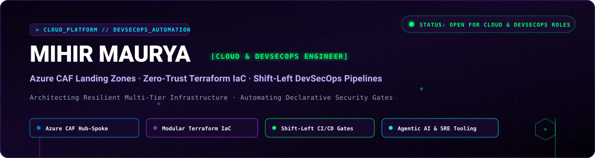
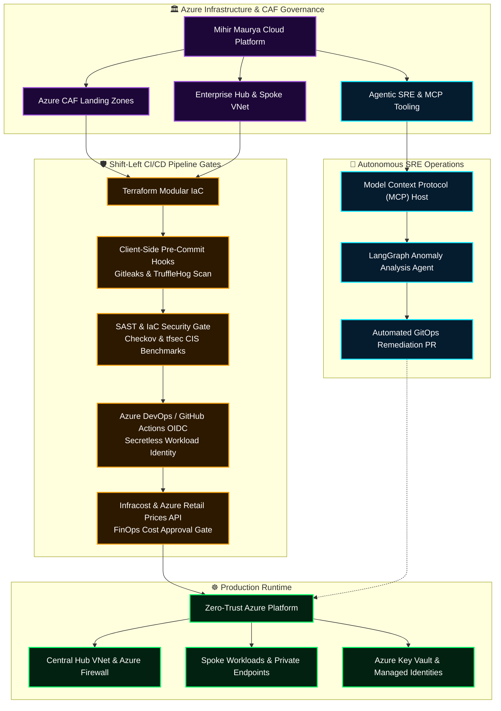
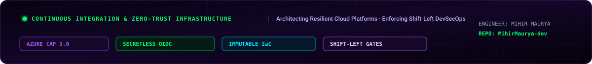

<div align="center">



<a href="https://readme-typing-svg.demolab.com/">
  
</a>

### ⚡ Cloud & DevSecOps Engineer | Azure Infrastructure & CI/CD Security Automation

**Scalable Azure Cloud Platforms · Zero-Trust Infrastructure as Code · Shift-Left Pipeline Governance · Autonomous Incident Triage**

[](https://mihirmaurya-dev.github.io/)
[](https://b18g119.online)
[](https://linkedin.com/in/mihirmauryaa1)
[](https://github.com/MihirMaurya-dev?tab=repositories)
[](#-lets-connect)

</div>

---

## 🧑‍💻 Professional Summary

I am a **Cloud & DevSecOps Engineer** dedicated to engineering resilient, automated **Microsoft Azure cloud platforms**, declarative **Infrastructure as Code (Terraform)**, and shift-left **CI/CD security pipelines** in GitHub Actions and Azure DevOps.

Combining hands-on cloud provisioning and pipeline automation with an analytical foundation in **Computer Applications & Mathematics (M.Sc Computer Science, B.Sc Mathematics & Computer Applications)**, I design infrastructure with strict security compliance, automated cost governance, and self-healing operations:

* ☁️ **Cloud Architecture & CAF Governance:** Architecting enterprise Hub-and-Spoke topologies, micro-segmented Virtual Networks, User Defined Routes (UDRs), Azure Bastion jumpboxes, NAT Gateways for static egress, and Azure Key Vault private endpoints.
* 🛡️ **Shift-Left DevSecOps & Supply Chain Security:** Hardening multi-stage CI/CD pipelines in Azure DevOps and GitHub Actions with secretless **Workload Identity Federation (OIDC)**, static code analysis (**Checkov**, **tfsec**, **TFLint**), and secret detection (**Gitleaks**, **TruffleHog**).
* ⚡ **Dynamic CI/CD Matrix & FinOps:** Authoring intelligent monorepo workflow bots utilizing `tj-actions/changed-files` for isolated multi-directory Terraform execution, integrated with **Infracost** and the **Azure Retail Prices API** to prevent budget overruns before merge.
* 🤖 **Agentic AI & SRE Automation:** Standardizing **Model Context Protocol (MCP)** servers and **LangGraph** cyclical state machines for automated infrastructure alert ingestion, runbook querying, and GitOps remediation pull requests.

---

## 🧭 Core Delivery Architecture



---

## 🚀 Featured Enterprise Projects

---

### 1. 🕸️ [`azure-hub-spoke-architecture`](https://github.com/MihirMaurya-dev/azure-hub-spoke-architecture)

> **Enterprise Azure Hub-and-Spoke Network Topology & CAF Landing Zone via Modular Terraform**

[](https://github.com/MihirMaurya-dev/azure-hub-spoke-architecture)
[](https://github.com/MihirMaurya-dev/azure-hub-spoke-architecture)
[](https://github.com/MihirMaurya-dev/azure-hub-spoke-architecture)
[](https://github.com/MihirMaurya-dev/azure-hub-spoke-architecture)

| Architectural Dimension | Engineering Implementation |
|---|---|
| 🏢 **Hub Infrastructure** | Centralized Hub VNet (`10.0.0.0/16`), `AzureFirewallSubnet`, `GatewaySubnet`, `BastionSubnet`, `ManagementSubnet`, and Private Key Vault |
| 🧪 **Spoke Segmentation** | Multi-environment isolation (`spoke-dev` at `10.1.0.0/16`, `spoke-prod` at `10.2.0.0/16`) interconnected via low-latency VNet Peering |
| 🛡️ **DevSecOps Harness** | Custom PowerShell CI simulator (`run-pipeline.ps1`) executing automated Checkov SAST, formatting checks, and plan artifact locking |
| 🔒 **State Decoupling** | Isolated remote state backends per environment in Azure Blob Storage with lease locking to prevent concurrency locks and blast radius |

<div align="center">

[](https://github.com/MihirMaurya-dev/azure-hub-spoke-architecture)
[](https://github.com/MihirMaurya-dev/azure-hub-spoke-architecture/tree/main/terraform/environments/hub)
[](https://github.com/MihirMaurya-dev/azure-hub-spoke-architecture/tree/main/terraform/modules/network)
[](https://github.com/MihirMaurya-dev/azure-hub-spoke-architecture/blob/main/run-pipeline.ps1)

</div>

<details>
<summary><b>🔬 [INSPECT ARCHITECTURE SPEC] Multi-Tenant Hub-and-Spoke Topologies</b></summary>

```text
HUB-SPOKE/
├── azure-pipelines.yml       # 🔄 Azure DevOps Multi-Stage CI/CD pipeline
├── run-pipeline.ps1          # 🛠️ Shift-Left Checkov + Terraform execution harness
└── terraform/
    ├── environments/         # 🚀 ISOLATED STATE ROOT DEPLOYMENTS
    │   ├── hub/              # Central Hub: VNet (10.0.0.0/16), VPN GW, Key Vault
    │   ├── spoke-dev/        # Dev Workload VNet (10.1.0.0/16) -> Peered to Hub
    │   └── spoke-prod/       # Prod Workload VNet (10.2.0.0/16) -> Peered to Hub
    │
    └── modules/              # 🧩 REUSABLE TERRAFORM MODULES
        ├── key_vault/        # Private Key Vault with RBAC & Access Policies
        ├── network/          # Dynamic VNet/Subnet generator via for_each
        └── vpn/              # Enterprise Gateway & P2S / S2S VPN
```
</details>

---

### 2. 🤖 [`Master_PipeLine`](https://github.com/MihirMaurya-dev/Master_PipeLine)

> **Enterprise Multi-Directory Terraform CI/CD Bot & Pre-Commit Security Engine**

[](https://github.com/MihirMaurya-dev/Master_PipeLine)
[](https://github.com/MihirMaurya-dev/Master_PipeLine)
[](https://github.com/MihirMaurya-dev/Master_PipeLine)
[](https://github.com/MihirMaurya-dev/Master_PipeLine)

| Pipeline Capability | Engineering Implementation |
|---|---|
| 📐 **Dynamic Matrix Runner** | Uses `tj-actions/changed-files` to isolate and execute only directories with modified `.tf` files in parallel GitHub Actions runners |
| 🛡️ **Shift-Left Pre-Commit** | Client-side hooks enforcing trailing whitespace, private key detection, Gitleaks regex scanning, and Terraform fmt/validation |
| 💰 **FinOps PR Automation** | Dynamic Infracost integration that computes cost differentials and writes monthly cost projections directly onto GitHub PRs |
| 💬 **Automated Plan Comments** | Generates detailed Terraform plan breakdowns and writes them as interactive PR comments for transparent reviewer verification |

<div align="center">

[](https://github.com/MihirMaurya-dev/Master_PipeLine)
[](https://github.com/MihirMaurya-dev/Master_PipeLine/blob/main/.github/workflows/terraform.yml)
[](https://github.com/MihirMaurya-dev/Master_PipeLine/blob/main/.pre-commit-config.yaml)

</div>

<details>
<summary><b>📐 [INSPECT WORKFLOW SPEC] Dynamic Change-Detection CI/CD Matrix</b></summary>

```yaml
name: Dynamic Matrix Terraform CI/CD

on:
  pull_request:
    branches: [main]

jobs:
  detect-changes:
    runs-on: ubuntu-latest
    outputs:
      tf_dirs: ${{ steps.set-matrix.outputs.directories }}
    steps:
      - uses: actions/checkout@v4
      - uses: tj-actions/changed-files@v44
        id: changed-files
        with:
          dir_names: true
          files: '**/*.tf'

  terraform-matrix:
    needs: detect-changes
    if: needs.detect-changes.outputs.tf_dirs != '[]'
    strategy:
      matrix:
        directory: ${{ fromJson(needs.detect-changes.outputs.tf_dirs) }}
    runs-on: ubuntu-latest
    steps:
      - uses: hashicorp/setup-terraform@v3
      - run: terraform fmt -check
      - run: terraform init -backend=false
      - run: terraform validate
      - uses: infracost/actions/setup@v3
      - run: infracost breakdown --path=${{ matrix.directory }} --format=json --out-file=infracost.json
```
</details>

---

### 3. 🛡️ [`master-devsecops-pipeline`](https://github.com/MihirMaurya-dev/master-devsecops-pipeline)

> **Enterprise 4-Stage Shift-Left Security, FinOps Cost Gating & Terraform CI/CD**

[](https://github.com/MihirMaurya-dev/master-devsecops-pipeline)
[](https://github.com/MihirMaurya-dev/master-devsecops-pipeline)
[](https://github.com/MihirMaurya-dev/master-devsecops-pipeline)
[](https://github.com/MihirMaurya-dev/master-devsecops-pipeline)

| Pipeline Stage | Engineering Role & Gate Enforcement |
|---|---|
| **Stage 1: Plan & FinOps** | Terraform `init`, `fmt`, `validate`, `tflint`, compiles `tfplan`, and queries **Azure Retail Prices API** dynamically |
| **Stage 2: Security Scan** | Multi-engine scan: **Gitleaks** regex secrets, **TruffleHog** verified tokens, **tfsec** CIS tests, and **Trivy** misconfigurations |
| **Stage 3: Approval Gate** | Azure DevOps Environment Gate (`production-approval`) enforcing architectural reviewer signoff before deploy |
| **Stage 4: Immutable Apply**| Downloads and applies the verified `tfplan` artifact directly with zero runtime configuration drift |

<div align="center">

[](https://github.com/MihirMaurya-dev/master-devsecops-pipeline)
[](https://github.com/MihirMaurya-dev/master-devsecops-pipeline/blob/main/terraform-pipeline/azure-pipelines.yml)
[](https://github.com/MihirMaurya-dev/master-devsecops-pipeline/blob/main/terraform-pipeline/.gitleaks.toml)

</div>

<details>
<summary><b>🔐 [INSPECT PIPELINE FLOW] 4-Stage Immutable CI/CD Lifecycle</b></summary>

```yaml
stages:
  - stage: Terraform_Plan
    jobs:
      - job: Plan_And_FinOps
        steps:
          - task: TerraformCLI@0 (init, validate, fmt -check)
          - task: PowerShell@2 (Query Azure Retail Prices API from tfplan JSON)
          - task: PublishPipelineArtifact (drop tfplan)

  - stage: DevSecOps_Security_Scan
    dependsOn: Terraform_Plan
    jobs:
      - job: Static_Analysis
        steps:
          - script: gitleaks detect --config .gitleaks.toml
          - script: trufflehog git file://. --only-verified
          - script: tfsec . --format junit --out tfsec-results.xml
          - script: trivy config . --severity CRITICAL,HIGH

  - stage: Production_Approval_Gate
    dependsOn: DevSecOps_Security_Scan
    jobs:
      - deployment: Human_Signoff
        environment: 'production-approval'

  - stage: Terraform_Apply
    dependsOn: Production_Approval_Gate
    jobs:
      - job: Apply
        steps:
          - task: DownloadPipelineArtifact (retrieve verified tfplan)
          - task: TerraformCLI@0 (apply tfplan)
```
</details>

---

### 4. 🏛️ [`azure-caf-modular-iac`](https://github.com/MihirMaurya-dev/azure-caf-modular-iac)

> **Modular Azure Infrastructure as Code Framework · CAF Enterprise Blueprints & Multi-Tier Compute**

[](https://github.com/MihirMaurya-dev/azure-caf-modular-iac)
[](https://github.com/MihirMaurya-dev/azure-caf-modular-iac)
[](https://github.com/MihirMaurya-dev/azure-caf-modular-iac)
[](https://github.com/MihirMaurya-dev/azure-caf-modular-iac)

| Modular Component | Design Pattern & Security Boundary |
|---|---|
| 🔒 **Azure Bastion** | Secure browser-based TLS jumpbox connectivity eliminating the need for public IP addresses on VMs |
| 🛡️ **NAT Gateway** | Deterministic static IP egress for private subnets ensuring predictable external firewall allowlisting |
| 🌐 **Virtual Networks** | Parameterized address spaces with subnet slicing, NSG security associations, and route table definitions |
| 🚀 **Environment Tiers** | Pre-configured `Dev` and `Prod` environment directories ready for automated CI/CD deployment |

<div align="center">

[](https://github.com/MihirMaurya-dev/azure-caf-modular-iac)
[](https://github.com/MihirMaurya-dev/azure-caf-modular-iac/tree/main/modules)
[](https://github.com/MihirMaurya-dev/azure-caf-modular-iac/tree/main/Environments)

</div>

---

## 🔬 Specialized Engineering Builds

| Repository & Focus | Architectural Innovation | Core Technologies | Verified Gate |
|:---|:---|:---|:---:|
| 🤖 **[`agentic-ai-devops`](https://github.com/MihirMaurya-dev/agentic-ai-devops)** | Autonomous SRE triage: Ingests alert webhooks via Model Context Protocol (MCP) and runs LangGraph agents to auto-draft remediation PRs | Model Context Protocol, LangGraph, Python, Prometheus | `Self-Healing PR` 🟢 |
| 🛡️ **[`genesis-iac-security-framework`](https://github.com/MihirMaurya-dev/genesis-iac-security-framework)** | Enterprise Terraform security suite: Custom Gitleaks regex detection patterns, TFLint policy rules, and multi-stage CI/CD validation | Terraform, Gitleaks, TFLint, Trivy | `Pre-Commit Gate` 🟢 |
| ⚡ **[`azure-devops-iis-automation`](https://github.com/MihirMaurya-dev/azure-devops-iis-automation)** | Self-hosted Windows agent pipeline: Automated .NET Core unit testing, Cobertura code coverage generation, and automated IIS site release | Azure DevOps, .NET Core, PowerShell, IIS | `Coverage Gate` 🟢 |

---

## 🔒 The Engineering Standard I Enforce

```
┌────────────────────────────────────────────────────────────────────────┐
│  1. ZERO-TRUST IDENTITY: Secretless Workload Identity Federation (OIDC)│
│  2. IMMUTABLE IaC: All infrastructure planned, audited, and applied    │
│  3. SHIFT-LEFT GATES: Checkov & Gitleaks block vulnerabilities at PR   │
│  4. BLAST-RADIUS ISOLATION: Decoupled remote states with lease locking │
│  5. COST GOVERNANCE: Infracost & Azure Retail Prices API gated in CI   │
└────────────────────────────────────────────────────────────────────────┘
```

---

## 🧰 Technology & Tooling Matrix

<div align="center">

<a href="https://skillicons.dev">
  
</a>

</div>

<br/>

| Domain | Enterprise Tools, Frameworks & Standards |
|:---|:---|
| ☁️ **Cloud Architecture** | Microsoft Azure, Hub-and-Spoke VNets, Azure Bastion, NAT Gateway, Azure Key Vault Private Endpoints, Azure Landing Zones (CAF), Azure Policy |
| 🏗️ **Infrastructure as Code** | Terraform, OpenTofu, Modular IaC, Azure Blob Remote State with Lease Locking, Dynamic `for_each` Subnet Generation, Drift Management |
| 🔄 **CI/CD & GitOps** | Azure DevOps Pipelines, GitHub Actions, Secretless OIDC Workload Identity, Dynamic Matrix Path Runners, Environment Approval Gates |
| 🛡️ **DevSecOps & Security** | Shift-Left Security, Checkov (CIS Microsoft Azure Benchmark), tfsec, Gitleaks, TruffleHog, TFLint, Trivy Vulnerability Scanning |
| 🤖 **Agentic AI & SRE** | Model Context Protocol (MCP), LangGraph Cyclical Agents, Automated Alert Ingestion, GitOps Self-Healing Workflows |
| ☸️ **Containers & Systems** | Docker, Linux (Ubuntu), Bash Scripting, PowerShell Core, REST API Architecture, Git Workflows |

---

## 📈 Engineering Activity

<div align="center">


</div>

<br/>

<div align="center">

[](https://github.com/MihirMaurya-dev?tab=repositories)
[](https://github.com/MihirMaurya-dev/azure-hub-spoke-architecture)
[](https://github.com/MihirMaurya-dev/Master_PipeLine)
[](https://mihirmaurya-dev.github.io/)

</div>

---

## 🗂️ Public Repository Directory

A comprehensive index of cloud infrastructure repositories, security scanners, and automation frameworks maintained across this profile:

| Repository & Focus | Architectural Scope | Core Tooling | Quality & Security Gate |
|:---|:---|:---|:---:|
| 🕸️ **[`azure-hub-spoke-architecture`](https://github.com/MihirMaurya-dev/azure-hub-spoke-architecture)** | Multi-Tenant Hub-and-Spoke Network Topology | Terraform, Bastion, VNet Peering | `Checkov CIS Gate` 🟢 |
| 🤖 **[`Master_PipeLine`](https://github.com/MihirMaurya-dev/Master_PipeLine)** | Monorepo Dynamic Matrix CI/CD Bot & Pre-Commit | GitHub Actions, Infracost, Pre-Commit | `Dynamic Matrix` 🟢 |
| 🛡️ **[`master-devsecops-pipeline`](https://github.com/MihirMaurya-dev/master-devsecops-pipeline)** | 4-Stage CI/CD Pipeline & Predictive FinOps | Azure DevOps, Gitleaks, tfsec, Trivy | `Azure Prices API` 🟢 |
| 🏛️ **[`azure-caf-modular-iac`](https://github.com/MihirMaurya-dev/azure-caf-modular-iac)** | Modular Azure Infrastructure & Multi-Tier Blueprints | Terraform Modules, Bastion, NAT GW | `Decoupled States` 🟢 |
| 🤖 **[`agentic-ai-devops`](https://github.com/MihirMaurya-dev/agentic-ai-devops)** | Autonomous Incident Triage & SRE Tooling | Model Context Protocol, LangGraph | `Self-Healing PR` 🟢 |
| 🛡️ **[`genesis-iac-security-framework`](https://github.com/MihirMaurya-dev/genesis-iac-security-framework)** | Custom Gitleaks Secret Detection & TFLint Suite | Custom Regex Rules, Terraform, TFLint | `Pre-Commit Gate` 🟢 |
| ⚡ **[`azure-devops-iis-automation`](https://github.com/MihirMaurya-dev/azure-devops-iis-automation)** | Self-Hosted Agent Pipeline & Automated IIS Site | .NET Core, Cobertura, PowerShell | `Coverage Gate` 🟢 |
| 🏢 **[`axion-enterprise-infra`](https://github.com/MihirMaurya-dev/axion-enterprise-infra)** | 3-Tier Web/App/Database Production Architecture | Ubuntu Linux VMs, Segmented Subnets | `GitHub Actions CI` 🟢 |
| 🔄 **[`PipeLine`](https://github.com/MihirMaurya-dev/PipeLine)** | Azure Infrastructure Terraform CI/CD Automation Engine | GitHub Actions, Checkov, TFLint | `CI/CD Passing` 🟢 |
| 📦 **[`Terraform`](https://github.com/MihirMaurya-dev/Terraform)** | Production Azure IaC Library & Load Balancers | Modular Terraform, Azure VNets | `Modular IaC` 🟢 |
| 🚀 **[`CI-CD`](https://github.com/MihirMaurya-dev/CI-CD)** | Continuous Integration & Deployment Pipeline Workflows | GitHub Actions, Azure IaC | `Automated CI` 🟢 |
| 🏋️ **[`FlexZone`](https://github.com/MihirMaurya-dev/FlexZone)** | High-Performance Workout Engine & REST API | PHP 8, MySQL, Cloudflare Edge | `Cloudflare Edge` 🟢 |
| 🌐 **[`MihirMaurya-dev.github.io`](https://github.com/MihirMaurya-dev/MihirMaurya-dev.github.io)** | Official Cloud & DevSecOps Engineer Portfolio Website | HTML5, CSS3, Modern JavaScript | `Static Edge Deploy` 🟢 |

---

## 🤝 Let's Connect

I am actively open to opportunities regarding **Cloud & DevSecOps Engineer** roles.

<div align="center">

[](https://mihirmaurya-dev.github.io/)
[](https://b18g119.online)
[](https://linkedin.com/in/mihirmauryaa1)
[](https://github.com/MihirMaurya-dev)
[](mailto:chhotuverma2238@gmail.com)

<br/><br/>



</div>
