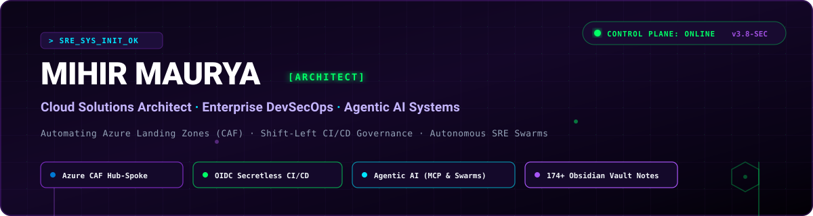
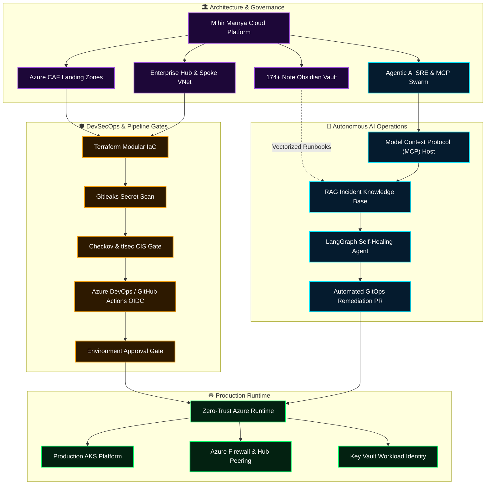
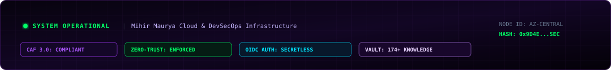

<div align="center">



<a href="https://readme-typing-svg.demolab.com/">
  
</a>

### ⚡ Enterprise Cloud Solutions Architect & DevSecOps Engineer | Agentic AI Systems

**Production Azure Infrastructure · Zero-Trust IaC · Shift-Left DevSecOps · Autonomous SRE Swarms**

[](https://linkedin.com/in/mihirmauryaa1)
[](https://b18g119.online)
[](https://github.com/MihirMaurya-dev?tab=repositories)
[](#-connect)

</div>

---

## 🛰️ Mission Control Telemetry Matrix

<div align="center">

| Subsystem | Telemetry Status | Architecture Standard | Gate Verification |
|:---|:---:|:---|:---:|
| ☁️ **Cloud Foundation** | `ONLINE` 🟢 | Azure Cloud Adoption Framework (CAF 3.0) | Multi-Subscription Hub & Spoke |
| 🛡️ **Supply Chain Security** | `ENFORCED` 🟢 | CIS Benchmark v2.0 · Checkov · tfsec | Automated Pre-Merge PR Gate |
| 🔑 **Identity & Access** | `SECRETLESS` 🟢 | Workload Identity Federation (OIDC) | Zero Static Service Principal Secrets |
| 🤖 **Agentic Incident AI** | `DEPLOYED` 🟢 | Model Context Protocol (MCP) · LangGraph | Self-Healing PR & Anomaly Triage |
| 📚 **Knowledge Repository** | `174+ RUNBOOKS` 🟢 | Markdown Obsidian Vault · 400+ Q&As | 16 Architecture Domains · ADR Engine |

</div>

---

## 🧑‍💻 Executive Summary

I am a **Cloud Solutions Architect and DevSecOps Engineer** specializing in enterprise-grade **Microsoft Azure platforms**, **Zero-Trust Infrastructure as Code (Terraform)**, and cutting-edge **Agentic AI systems (Model Context Protocol, RAG, and autonomous SRE operations)**.

Combining an analytical foundation in **Computer Applications & Mathematics (M.Sc Computer Science)** with intensive immersion in **DevOps Insiders (Batch 18)**, I engineer production platforms designed for high resilience, verifiable security compliance, and automated self-healing operations:

* ☁️ **Cloud Architecture & CAF Governance:** Architecting enterprise Hub-and-Spoke topologies, micro-segmented Virtual Networks, Route Tables with forced egress, Azure Firewall Premium, and production AKS clusters.
* 🛡️ **Shift-Left DevSecOps & Supply Chain:** Authoring 4-stage automated pipelines in Azure DevOps and GitHub Actions with secretless OIDC authentication, static code analysis (**Checkov**, **tfsec**, **TFLint**), secret scanning (**Gitleaks**), and manual approval gates.
* 🤖 **Agentic AI & LLMOps:** Implementing **Model Context Protocol (MCP)** servers and **LangGraph** multi-agent swarms that ingest live infrastructure alerts, retrieve runbooks from vector stores, and autonomously generate remediation GitOps pull requests.
* 🧠 **Systemized Architectural Knowledge:** Architect of a **174+ note production-grade Obsidian Knowledge Vault** spanning 16 domains, 33 Azure services, 400+ scenario interview questions, and real-world Architecture Decision Records (ADRs).

---

## 🧭 Portfolio Delivery Architecture



---

## 🚀 Featured Enterprise Projects

### 1. 🕸️ [`azure-hub-spoke-architecture`](https://github.com/MihirMaurya-dev/azure-hub-spoke-architecture)
Production-grade, multi-environment Hub-and-Spoke networking framework for Microsoft Azure deployed via modular Terraform.
* **Architecture:** Deploys a central **Hub VNet** (hosting Azure VPN Gateway, Key Vault, and shared egress) interconnected with isolated **Spoke VNets** (`Dev`, `Prod`) via bidirectional VNet Peering with dynamic subnet generators (`for_each`).
* **DevSecOps Simulation:** Built with a custom PowerShell CI/CD execution harness enforcing static security scanning (`checkov`), strict format validation (`terraform fmt`), and plan artifact locking before execution.
* **State Isolation:** Decoupled remote state backends for each environment to eliminate blast radiuses and prevent concurrent deployment state locks.

[**Explore Hub-Spoke Codebase →**](https://github.com/MihirMaurya-dev/azure-hub-spoke-architecture) · [**Hub Deployment**](https://github.com/MihirMaurya-dev/azure-hub-spoke-architecture/tree/main/terraform/environments/hub) · [**Network Modules**](https://github.com/MihirMaurya-dev/azure-hub-spoke-architecture/tree/main/terraform/modules/network) · [**Pipeline Harness**](https://github.com/MihirMaurya-dev/azure-hub-spoke-architecture/blob/main/run-pipeline.ps1)

<details>
<summary><b>🔬 [INSPECT ARCHITECTURE SPEC] Multi-Tenant Hub-and-Spoke Topologies</b></summary>

```text
HUB-SPOKE/
├── terraform/
│   ├── environments/         # 🚀 ISOLATED STATE ROOT DEPLOYMENTS
│   │   ├── hub/              # Central Hub: VNet (10.0.0.0/16), VPN GW, Key Vault
│   │   ├── spoke-dev/        # Dev Workload VNet (10.1.0.0/16) -> Peered to Hub
│   │   └── spoke-prod/       # Prod Workload VNet (10.2.0.0/16) -> Peered to Hub
│   │
│   └── modules/              # 🧩 REUSABLE TERRAFORM MODULES
│       ├── key_vault/        # Private Key Vault with RBAC & Access Policies
│       ├── network/          # Dynamic VNet/Subnet generator via for_each
│       └── vpn/              # Enterprise Gateway & P2S / S2S VPN
└── run-pipeline.ps1          # 🛠️ Shift-Left Checkov + Terraform Pipeline Harness
```
</details>

---

### 2. 🛡️ [`master-devsecops-pipeline`](https://github.com/MihirMaurya-dev/master-devsecops-pipeline)
Enterprise 4-stage Azure DevOps and GitHub Actions CI/CD framework enforcing shift-left supply chain security and immutable plan execution.
* **Stage Flow:** `Stage 1: Terraform Plan` ➔ `Stage 2: Shift-Left Security (tfsec, Checkov, Gitleaks)` ➔ `Stage 3: Manual Environment Approval Gate` ➔ `Stage 4: Terraform Apply with Saved Plan Artifact`.
* **Zero-Trust Identity:** Completely eliminates permanent service principal secret keys by authenticating via **Workload Identity Federation (OIDC)**.
* **Audit & Compliance:** Publishes JUnit-formatted compliance reports directly into Azure DevOps pipelines for instant vulnerability visibility.

[**Explore DevSecOps Pipeline →**](https://github.com/MihirMaurya-dev/master-devsecops-pipeline) · [**Azure Pipelines YAML**](https://github.com/MihirMaurya-dev/master-devsecops-pipeline/blob/main/terraform-pipeline/azure-pipelines.yml) · [**Gitleaks Policy**](https://github.com/MihirMaurya-dev/master-devsecops-pipeline/blob/main/terraform-pipeline/.gitleaks.toml)

<details>
<summary><b>🔐 [INSPECT PIPELINE FLOW] 4-Stage Immutable CI/CD Lifecycle</b></summary>

```yaml
stages:
  - stage: Terraform_Plan
    jobs:
      - job: Plan
        steps:
          - task: TerraformCLI@0 (init, validate, fmt -check)
          - task: TerraformCLI@0 (plan -out=tfplan)
          - task: PublishPipelineArtifact (drop tfplan)

  - stage: DevSecOps_Security_Scan
    dependsOn: Terraform_Plan
    jobs:
      - job: Static_Analysis
        steps:
          - script: tfsec . --format junit --out tfsec-results.xml
          - script: checkov -d . --framework terraform --output junitxml > checkov.xml
          - script: gitleaks detect --verbose --config .gitleaks.toml

  - stage: Production_Approval_Gate
    dependsOn: DevSecOps_Security_Scan
    jobs:
      - deployment: Human_Signoff
        environment: 'production-approval' # Required business reviewer approval

  - stage: Terraform_Apply
    dependsOn: Production_Approval_Gate
    jobs:
      - job: Apply
        steps:
          - task: DownloadPipelineArtifact (retrieve verified tfplan)
          - task: TerraformCLI@0 (apply tfplan)
```
</details>

---

### 3. 🧠 [`devops-knowledge-vault`](https://github.com/MihirMaurya-dev/DevOps-Notes)
Production-grade Obsidian Knowledge Engine and architectural runbook vault covering the entire cloud & DevSecOps lifecycle.
* **Scope:** **174+ curated notes** across 16 core domains including Terraform HCL internals, 33 Azure services, Microsoft CAF Landing Zone mapping, and CI/CD hardening.
* **Architectural Decision Records (ADRs):** Contains real-world decision logs explaining rationale, tradeoffs, and compliance justifications for enterprise designs.
* **Interview & Scenario Engine:** 400+ scenario-based interview deep dives, cheat sheets, and whiteboard architectural breakdowns.

[**Explore Knowledge Vault →**](https://github.com/MihirMaurya-dev/DevOps-Notes) · [**CAF Mapping**](https://github.com/MihirMaurya-dev/DevOps-Notes) · [**Decision Logs (ADRs)**](https://github.com/MihirMaurya-dev/DevOps-Notes) · [**Interview Scenarios**](https://github.com/MihirMaurya-dev/DevOps-Notes)

<details>
<summary><b>📚 [INSPECT VAULT STRUCTURE] 16 Architecture Domains</b></summary>

| Index | Domain | Focus Areas |
|:---:|:---|:---|
| `01` | **Terraform** | HCL, State Locking, Custom Modules, Workspaces, Loops & Dynamic Blocks |
| `02` | **Azure** | 33 Services, AKS, VNet Peering, Private Endpoints, RBAC, Key Vault |
| `03` | **Landing Zone** | Microsoft CAF, Management Groups, Policy-as-Code, Subscription Design |
| `04` | **CI/CD** | Multi-Stage Pipelines, OIDC Workload Federation, Approval Gates, GitOps |
| `05` | **Linux** | Kernel Parameters, Systemd Services, Bash Scripting, Networking (iptables/ss) |
| `06` | **Architecture** | Hub-and-Spoke, Zero-Trust, Disaster Recovery (RTO/RPO), High Availability |
| `07` | **Interview Prep** | Scenario Whiteboarding, System Design Q&As, Troubleshooting Runbooks |
| `08` | **Real Builds** | Multi-Tier Enterprise Infrastructure, AKS Production Platforms |
| `09` | **Decision Logs** | Architectural Decision Records (ADR-001 through ADR-004) |
| `12` | **Agentic AI** | Model Context Protocol (MCP), ReAct Agents, LangGraph SRE Swarms |
| `14` | **Security** | Checkov, tfsec, TFLint, Gitleaks, Cosign, Trivy Vulnerability Scanning |
| `15` | **Cost Governance**| FinOps, Azure Cost Analysis, Resource Tagging, Infracost Budget Gates |

</details>

---

### 4. 🤖 [`agentic-devops-sre-mcp`](https://github.com/MihirMaurya-dev/DevOps-Notes/tree/main/12-Agentic-AI)
Autonomous Incident Response & SRE Swarm framework leveraging Anthropic's **Model Context Protocol (MCP)** and **LangGraph**.
* **Autonomous Triage:** Consumes alert webhooks from Azure Monitor / Prometheus, queries the vectorized Obsidian Knowledge Vault via Qdrant/ChromaDB for remediation runbooks.
* **Tool Calling via MCP:** Connects directly to Azure Resource Manager and Kubernetes API via secure MCP servers to inspect pod telemetry and diagnose crash loops.
* **Self-Healing GitOps:** Automatically drafts verified pull requests containing IaC resource fixes and automated rollback configs with zero human intervention required for routine errors.

[**Explore Agentic SRE Runbooks →**](https://github.com/MihirMaurya-dev/DevOps-Notes/tree/main/12-Agentic-AI) · [**ReAct Patterns**](https://github.com/MihirMaurya-dev/DevOps-Notes) · [**Tool-Calling Engine**](https://github.com/MihirMaurya-dev/DevOps-Notes)

---

### 5. 🏥 [`medikiosk-edge-platform`](https://github.com/MihirMaurya-dev/medikiosk-sih26047)
Distributed IoT & resilient healthcare kiosk architecture engineered for the **Smart India Hackathon (SIH)**.
* **Edge Resilience:** Built with an offline-first microservices architecture ensuring health diagnostic kiosks continue functioning during intermittent network drops.
* **Cloud Telemetry:** Integrates edge telemetry ingestion with cloud storage and automated data synchronization once connectivity resumes.

[**Explore MediKiosk Architecture →**](https://github.com/MihirMaurya-dev/medikiosk-sih26047) · [**Architecture Spec**](https://github.com/MihirMaurya-dev/medikiosk-sih26047/blob/main/ARCHITECTURE.md) · [**Backend Modules**](https://github.com/MihirMaurya-dev/medikiosk-sih26047/tree/main/backend)

---

## 🏛️ Architectural Decision Records (ADR Showcase)

Demonstrating the architectural rationale and risk-tradeoff evaluations applied across production environments:

| ADR ID | Decision Title | Architectural Choice & Tradeoff Rationale | Status |
|:---:|:---|:---|:---:|
| **ADR-001** | **Workload Identity (OIDC) vs Service Principals** | **Selected OIDC.** Eliminated long-lived client secrets stored in CI/CD variables; uses short-lived Azure AD tokens issued directly to GitHub/Azure DevOps runners. Eliminates credential leakage attack surface. | `ACCEPTED` 🟢 |
| **ADR-002** | **Central Hub-and-Spoke vs Full Mesh VNet** | **Selected Hub-Spoke.** Enforces all cross-environment and outbound egress through a centralized firewall with User Defined Routes (UDRs), avoiding complex N*(N-1)/2 mesh peering costs and lack of visibility. | `ACCEPTED` 🟢 |
| **ADR-003** | **Decoupled Remote States vs Monolithic State** | **Selected Decoupled State.** Split Hub, Spoke-Dev, and Spoke-Prod states into distinct Azure Blob containers with lease locking, preventing accidental blast radiuses and pipeline concurrency locks. | `ACCEPTED` 🟢 |
| **ADR-004** | **Model Context Protocol (MCP) for SRE AI** | **Selected MCP Standard.** Provides a standardized, sandboxed protocol for AI agents to invoke Azure CLI and Kubernetes tools with strict permission boundaries rather than unsafe bash scripts. | `ACCEPTED` 🟢 |

---

## 🧰 Technology & Tooling Matrix

<div align="center">

<a href="https://skillicons.dev">
  
</a>

</div>

<br/>

| Domain | Enterprise Tools, Frameworks & Standards |
|:---|:---|
| ☁️ **Cloud Architecture** | Microsoft Azure, Hub-and-Spoke VNets, ExpressRoute / VPN GW, Azure Firewall, Private Endpoints, Azure Landing Zones (CAF), Azure Policy |
| 🏗️ **Infrastructure as Code** | Terraform, OpenTofu, Modular IaC, Azure Blob Remote State with Lease Locking, Dynamic `for_each` Subnet Generation, Drift Management |
| 🔄 **CI/CD & GitOps** | Azure DevOps Pipelines, GitHub Actions, Secretless OIDC Workload Identity, 4-Stage Gate Lifecycles, Environment Manual Approval Gates |
| 🛡️ **DevSecOps & Supply Chain** | Shift-Left Security, Checkov (CIS Microsoft Azure Benchmark), tfsec, Gitleaks, TFLint, Prisma Cloud, HashiCorp Key Vault |
| 🤖 **Agentic AI & SRE** | Model Context Protocol (MCP), LangGraph, Vector Knowledge Bases (Qdrant/ChromaDB), ReAct Autonomous Loops, Self-Healing Incident Workflows |
| ☸️ **Containers & Platforms** | Azure Kubernetes Service (AKS), Docker, Helm 3, ACR, Key Vault CSI Driver, OIDC Workload Identity for Pods |
| 📊 **Observability & Ops** | Azure Monitor, Log Analytics (KQL), Prometheus, Grafana, OpenCost, Health Probes, Data Collection Rules (DCR) |
| 💻 **Systems & Scripting** | Linux (Ubuntu), Bash, PowerShell Core, Python 3, PHP 8, REST API Architecture, Git Workflows |

---

## 🔒 The Engineering Standard I Enforce

```
┌────────────────────────────────────────────────────────────────────────┐
│  1. ZERO-TRUST IDENTITY: No static passwords or client secrets in CI   │
│  2. IMMUTABLE IaC: All infrastructure versioned and drift-detected     │
│  3. SHIFT-LEFT GATES: Checkov & Gitleaks block vulnerabilities at PR   │
│  4. ARCHITECTURAL RIGOR: Every major design documented via an ADR      │
│  5. AUTONOMOUS RESILIENCE: AI agents augment SRE for rapid MTTR triage │
└────────────────────────────────────────────────────────────────────────┘
```

---

## 📈 Engineering Telemetry

<div align="center">


</div>

<br/>

<div align="center">

[](https://github.com/MihirMaurya-dev?tab=repositories)
[](https://github.com/MihirMaurya-dev/DevOps-Notes)
[](https://github.com/MihirMaurya-dev/DevOps-Notes)
[](https://b18g119.online)

</div>

---

## 🤝 Let's Connect

I am actively open to discussions regarding **DevSecOps Engineer**, **Cloud Solutions Architect**, and **Agentic AI Platform** opportunities.

<div align="center">

[](https://linkedin.com/in/mihirmauryaa1)
[](https://b18g119.online)
[](https://www.instagram.com/mihirmauryaa/)
[](https://github.com/MihirMaurya-dev/DevOps-Notes)

<br/><br/>



</div>
